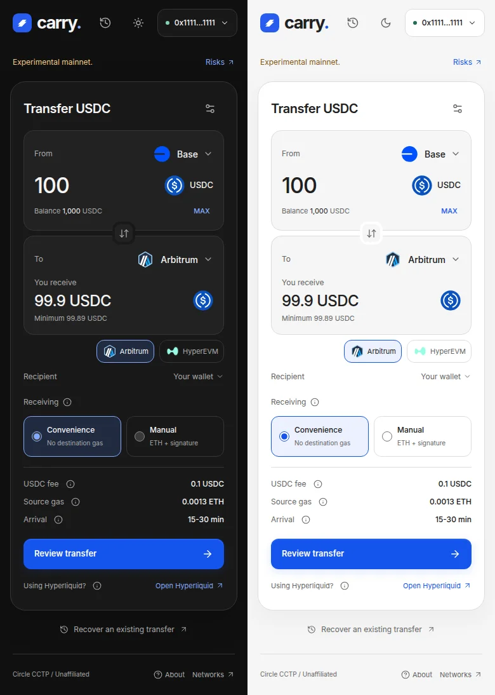

# Carry

**Native USDC across 25 networks. No app fees.**

Carry is a self-hostable frontend for [Circle CCTP](https://developers.circle.com/cctp). It uses Circle's native burn-and-mint protocol, with no liquidity pool, wrapped token or swap spread. Your wallet signs each transaction.

[](https://github.com/Xipzer/carry/actions/workflows/check.yml)
[](https://www.typescriptlang.org/)



## Why Carry

- **Low cost:** no Carry fee. Circle currently charges no Standard Transfer protocol fee; gas and optional automatic receiving still cost money.
- **Native USDC:** burn on the source network, mint on the destination through Circle's contracts.
- **Automatic receiving:** confirm the source transactions, then Circle handles delivery. Progress survives refresh.
- **Self-hostable:** static files, no database, backend or server wallet.

Carry is independent of Circle. Total cost depends on the route, gas and receiving mode. [Circle's fee documentation](https://developers.circle.com/cctp/concepts/fees) covers protocol charges; Carry fetches live fees before signing.

## Run

Install Node.js 24 and Git, then:

```sh
git clone https://github.com/Xipzer/carry.git
cd carry
npm ci --ignore-scripts
cp .env.example .env.local
npm run dev
```

Open the local URL printed by Vite. Use WSL on Windows. Browser wallets need no API key. WalletConnect needs a public [Reown project ID](https://dashboard.reown.com) and an allowed origin.

New mainnet sends are disabled by default. Testnet transfers and recovery work without enabling them. Deploy with [Vercel](https://vercel.com/new/clone?repository-url=https%3A%2F%2Fgithub.com%2FXipzer%2Fcarry) or [Render](https://render.com/deploy?repo=https://github.com/Xipzer/carry); read [deployment](docs/DEPLOYMENT.md) before enabling mainnet.

## Transfer

1. Connect your wallet. Choose the networks, amount and receiving address.
2. Choose **Convenience** for automatic receiving, or **Manual** to pay destination gas yourself.
3. Review the amount, fee cap and address. Approve USDC if needed, then confirm the send.

Convenience finishes without another signature. Manual needs a destination transaction. Standard finality often takes 15-30 minutes; Linea can take 6-32 hours. The app shows route-specific estimates.

Progress is saved in your browser. If interrupted, open Activity or recover with the source transaction hash. Never repeat the source send to fix a receiving delay.

## Networks

Arbitrum, Arc, Avalanche, Base, Codex, Cronos, EDGE, Ethereum, HyperEVM, Injective, Ink, Linea, Monad, Morph, Optimism, Pharos, Plasma, Plume, Polygon, Sei, Sonic, Unichain, World Chain, XDC and X Layer.

Each has a testnet entry. [Network details](docs/NETWORKS.md) list chain IDs and automatic-receiving support. Solana and other non-EVM networks are outside this frontend's scope.

## Develop

```sh
npx playwright install chromium
npm run verify
```

React, TypeScript, Vite and Viem. Tests use mocked wallets and RPC responses; they do not move funds. See [CONTRIBUTING.md](CONTRIBUTING.md).

For an agent, open the checkout and ask:

> Read AGENTS.md. Set up Carry, run its checks and explain any failures. Do not enable mainnet or deploy without my approval.

## Documentation

- [Architecture and transfer flow](docs/ARCHITECTURE.md)
- [Configuration and deployment](docs/DEPLOYMENT.md)
- [Recovery and troubleshooting](docs/RECOVERY.md)
- [Security and privacy](SECURITY.md)
- [Agent workflow](AGENTS.md)
- [Dependencies](DEPENDENCIES.md), [deployment registry](CCTP_REGISTRY.md), [artwork](BRAND_ASSETS.md)

## Licence

[Apache-2.0](LICENSE). Copyright 2026 [Xipz](https://github.com/Xipzer). Circle data and third-party artwork retain their own terms; see [NOTICE](NOTICE).
